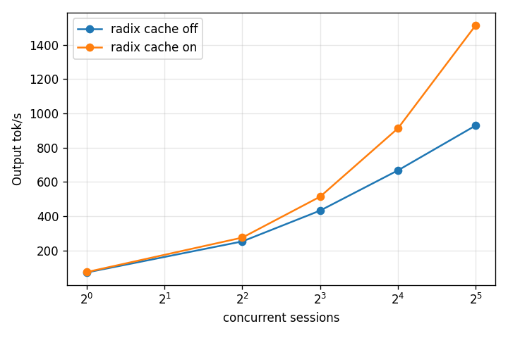
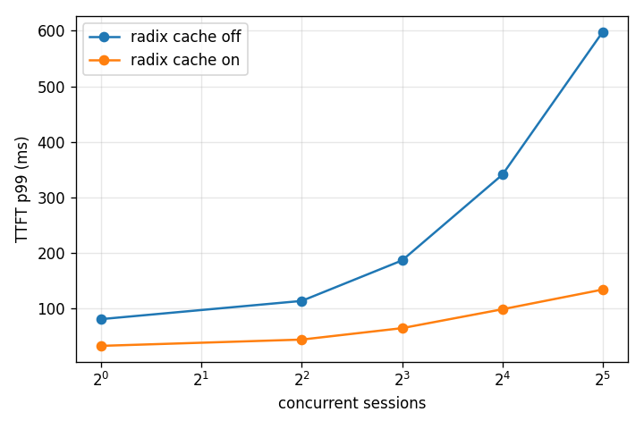
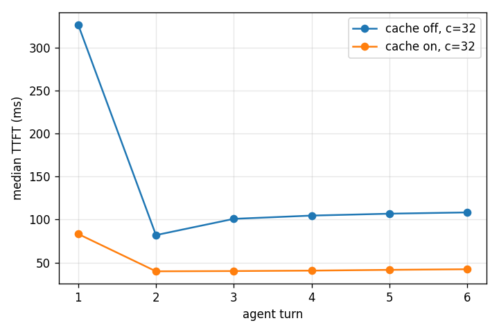

# DRAFT, not posted: SGLang on TPU v6e, multi-turn agent serving performance

**TL;DR:** On one Cloud TPU v6e chip, Qwen2.5-7B-Instruct served by SGLang (sgl_jax) with the radix prefix cache on
does **1,515 output tok/s at 32 concurrent agent sessions vs 930 tok/s with it off (+63%)**, and cuts **TTFT p99 from
598 ms to 134 ms (4.5x)**. 84-88% of prompt tokens are served from cache. Median TTFT stays flat at ~40 ms across turns.

## Why agents are different
Agent sessions resend a long shared system prompt (tool schemas) and append a tool result every turn,
so the prompt grows each turn. Chat benchmarks (one-shot random prompts) miss this. The question is
whether the radix prefix cache keeps per-turn latency flat on TPU.

## Setup
- Hardware: Cloud TPU v6e-1 (1 chip, 31.24 GiB HBM), us-east5-b, on-demand (spot attempt was preempted after ~5 min).
- Model: Qwen/Qwen2.5-7B-Instruct, bf16, TP=1 (ungated). v6e-8 + Qwen2.5-72B (TP=8): see v6e-8 section.
- Server: sgl_jax (sgl-project/sglang-jax, main @ 2026-11-18), `--attention-backend=fa --page-size=128
  --chunked-prefill-size=2048 --mem-fraction-static=0.85 --max-running-requests=128 --enable-cache-report`;
  cache-off run adds `--disable-radix-cache`. KV pool: 231,552 tokens (12.4 GB).
- Workload: 4 sessions per concurrency level x 6 turns (c x 4 sessions x 6 = 24..768 requests), 600-word shared
  system prompt, 150-word tool results, 128 max output tokens, temperature 0. Mean prompt ~1,240 tokens.
  Concurrency 1/4/8/16/32. Harness: github.com/kitrakrev/sglang-tpu-agentbench (agentbench).
- Cost basis: $2.70/chip-h on-demand (what was billed), $1.00/chip-h spot (estimate).

## Results: v6e-1, Qwen2.5-7B
| cache | c | out tok/s | req/s | TTFT p50/p90/p99 ms | ITL p50/p90/p99 ms | E2E p50/p99 ms | cached % | TTFT t1 / t6 ms | $/1M out (OD / spot) |
|---|---|---|---|---|---|---|---|---|---|
| on | 1 | 75.0 | 1.26 | 30.2 / 31.5 / 32.7 | 12.88 / 12.91 / 12.92 | 392 / 1674 | 84.1 | 28.5 / 30.5 | 10.01 / 3.71 |
| on | 4 | 275.9 | 3.96 | 39.5 / 40.6 / 44.0 | 13.59 / 13.96 / 14.74 | 562 / 1826 | 85.5 | 29.8 / 40.2 | 2.72 / 1.01 |
| on | 8 | 514.7 | 7.45 | 39.8 / 51.8 / 64.6 | 14.48 / 14.90 / 15.36 | 581 / 1961 | 87.7 | 45.1 / 40.2 | 1.46 / 0.54 |
| on | 16 | 913.4 | 14.11 | 40.6 / 76.7 / 98.6 | 16.39 / 17.13 / 18.38 | 563 / 2195 | 87.2 | 76.4 / 41.2 | 0.82 / 0.30 |
| on | 32 | **1515.2** | 24.45 | 42.1 / 95.4 / **134.1** | 19.83 / 21.01 / 22.51 | 650 / 2682 | 87.6 | 83.2 / 42.2 | **0.50 / 0.18** |
| off | 1 | 72.4 | 1.22 | 63.5 / 67.1 / 80.8 | 12.86 / 12.91 / 12.94 | 426 / 1725 | 0 | 42.5 / 66.6 | 10.36 / 3.84 |
| off | 4 | 253.6 | 3.60 | 73.6 / 94.5 / 113.6 | 14.56 / 15.58 / 16.62 | 635 / 2076 | 0 | 82.3 / 74.6 | 2.96 / 1.10 |
| off | 8 | 433.5 | 6.21 | 74.0 / 128.2 / 186.5 | 16.93 / 18.65 / 20.33 | 785 / 2437 | 0 | 128.1 / 75.3 | 1.73 / 0.64 |
| off | 16 | 668.1 | 10.36 | 76.5 / 198.0 / 340.9 | 22.28 / 25.24 / 28.33 | 861 / 3190 | 0 | 195.3 / 76.9 | 1.12 / 0.42 |
| off | 32 | 930.0 | 15.27 | 109.2 / 358.5 / 598.1 | 32.39 / 37.01 / 41.58 | 1208 / 4684 | 0 | 326.5 / 108.3 | 0.81 / 0.30 |

Error rate 0% on all 1,920 requests. Tokens/s per chip = out tok/s (1 chip). HBM: 27.08 / 31.24 GiB after load
(weights + pre-allocated KV pool), 27.09-27.18 GiB after the sweep. Server startup 40 s incl. XLA precompile of
5 EXTEND + 8 DECODE buckets (~17 s, with a warm `JAX_COMPILATION_CACHE_DIR`); post-start warmup 1-2 s.
Cold (empty cache) compile time was not captured cleanly (first run was restarted).

Charts: `results/v6e-1-qwen7b/charts/` (output_tok_per_s, ttft_p50_ms, ttft_p99_ms, itl_p50_ms, e2e_p99_ms, ttft_by_turn).

## Findings
1. Prefix caching matters more as concurrency grows: +4% tok/s at c=1, +63% at c=32; TTFT p99 2.5x lower at c=1, 4.5x at c=32.
   With cache off, prefill of ~1.2k tokens per request competes with decode and inflates ITL p50 (32 vs 20 ms at c=32).
2. The cache hit rate is 84-88% from turn 1, because the 600-word system prompt is shared by every session. Later turns
   also reuse each session's own history.
3. Turn-1 TTFT at high concurrency is dominated by the burst of sessions starting together (cache off: 327 ms turn 1 vs
   108 ms turn 6 at c=32), not by prompt length. That makes "turn 1 / turn N" a queueing metric here, not a cache metric.
4. Cost: $0.50 per 1M output tokens at on-demand price, ~$0.18 at spot, at c=32 with cache on.
5. Gotchas: v6e spot capacity was unavailable in us-east5-b and us-east1-d; the europe-west4-a spot VM was preempted
   within minutes. XLA precompile runs at server start (keep JAX_COMPILATION_CACHE_DIR between restarts). sgl_jax
   accepts `--enable-cache-report` and `--disable-radix-cache` unchanged.

## v6e-8, Qwen2.5-72B
Not run yet. On 2026-11-18 ~09:50-10:05 PST, v6e-8 spot had no capacity in us-east5-b, europe-west4-a, us-east1-d,
us-central1-b, asia-northeast1-b or us-south1-a. Config is ready: `configs/v6e-8-qwen72b.env` (Qwen2.5-72B-Instruct, TP=8).

## Cost
About $1 of TPU time so far (covered by credits): ~0.3 chip-h on-demand v6e-1 ($0.81) plus ~0.1 chip-h of a preempted spot VM (~$0.10).
The full v6e-1 cache on + off sweep took ~7 minutes of benchmark time.

## Next
EAGLE3 speculative decoding for agent turns; host-memory KV offload for long sessions; longer sessions (20+ turns) where per-session history dominates.
